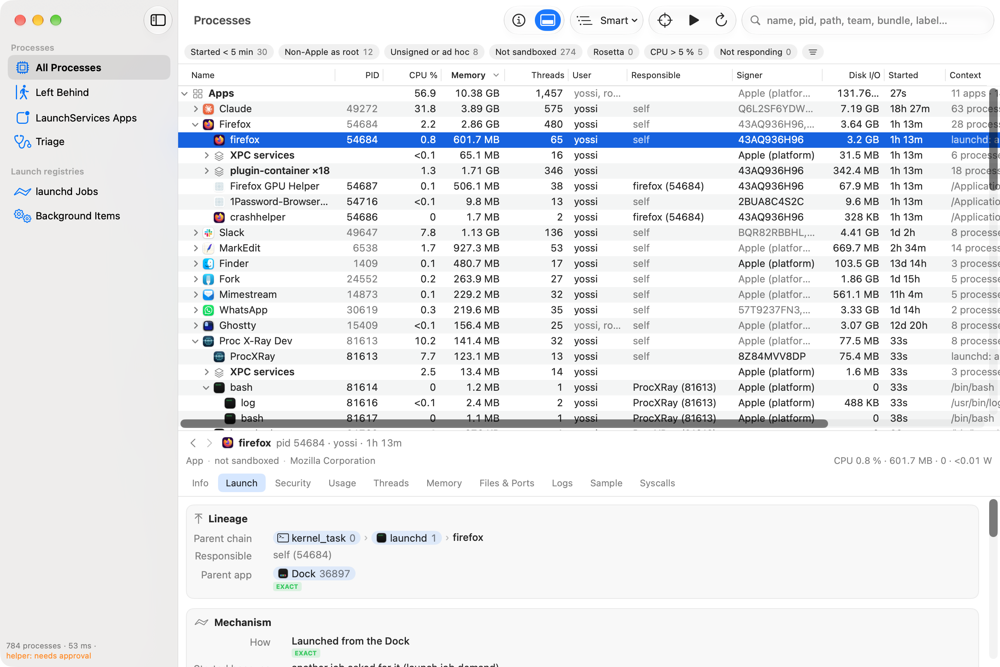
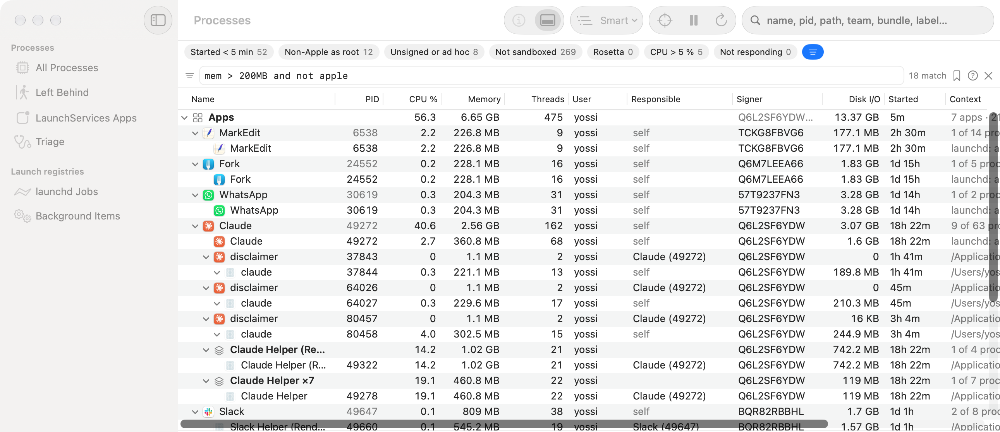
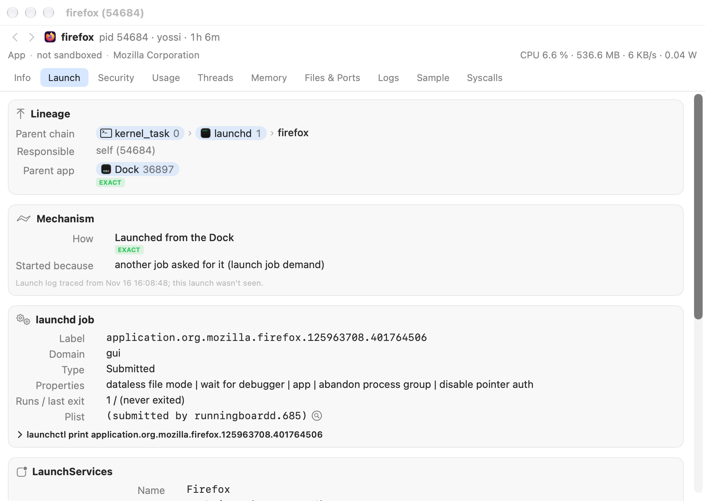
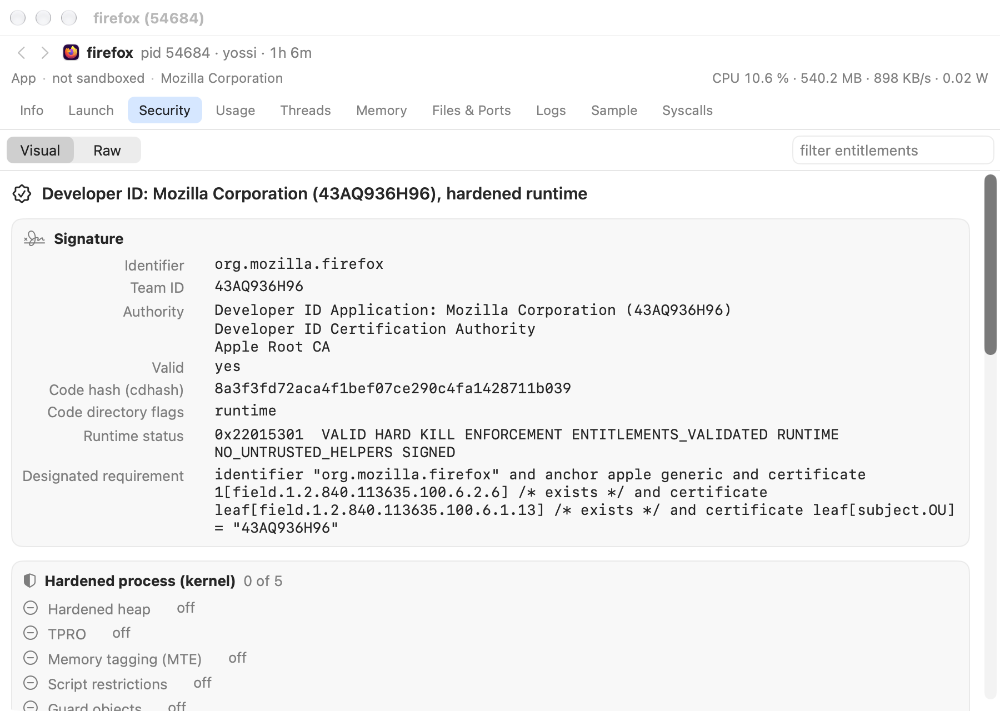
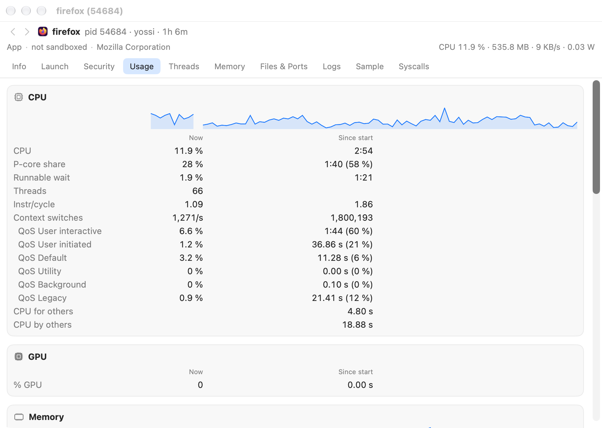
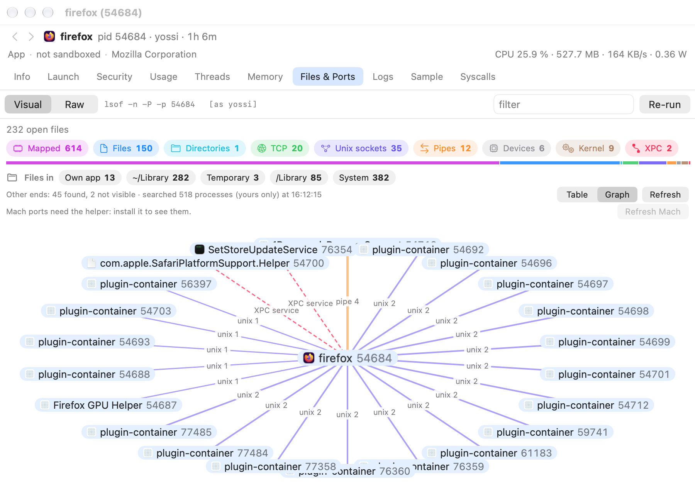
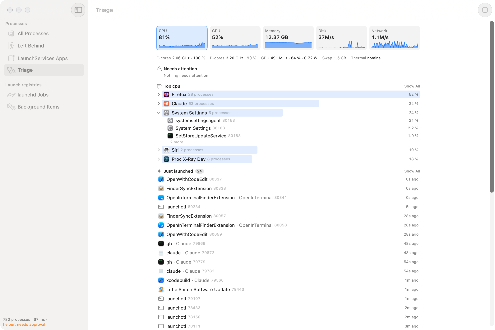

# Proc X-Ray

A process explorer for macOS in the spirit of Process Hacker. It shows what is running, who it belongs to, who started it and what it costs, using the attribution data macOS itself keeps: responsible processes, coalitions, LaunchServices, code signatures, launchd and Background Items.



## Highlights

- **A tree that groups by app.** Every process sits under the app or service it works for, so Firefox and all its helpers are one row with one total.
- **Filter on anything.** One-click chips for the usual suspects, or an expression such as `mem > 200MB and not apple`.
- **An inspector with ten tabs.** Identity, launch history, signature and sandbox, usage, threads, memory, open files and ports, logs, stack samples and system calls.
- **Every value says where it comes from.** Click a field's name to see what it means and which API or tool produced it.
- **Pictures instead of tool output.** `lsof`, `vmmap`, `sample` and `log` are drawn as graphs, charts and call trees, with the raw text one click away.
- **A menu bar monitor.** Live CPU, GPU, memory, disk and network, and a ranking of apps rather than single processes.
- **Light.** It reads only what the columns on screen need.

## A closer look

### The process list

Apps, background apps, extensions and services are sorted into categories, with each app's helpers, XPC services and terminal sessions under it. Group rows add up their members. About 75 columns in eleven sections cover identity, lineage, CPU, GPU, memory, disk, network, IPC, energy and security.

Prefer another view? Switch to a responsible/parent tree or a flat list, group by signer, user, launchd domain, sandbox or architecture, or click a column header to sort everything by it.

### Filters

Chips catch recently started, unsigned, unsandboxed, busy and non-Apple root processes. The predicate row takes expressions over any column, and a filter can be saved under a name.



### Why is it running?

The Launch tab traces a process back: its parent chain, the process macOS holds responsible, how it was started and why, and its launchd, LaunchServices and Background Items records.



### What is it allowed to do?

The Security tab shows the signature, hardening, sandbox (with live checks of what it can read and write), privacy permissions and entitlements.



### What does it cost?

Every figure now and since the process started, with its history.



### What is it talking to?

Open files, sockets and pipes, with the process on the other end of each one resolved into a graph.



### Memory and stacks

`vmmap` as tiles and a per-region chart, and `sample` as a call tree with the busy threads marked.


### Triage and the menu bar

The menu bar item shows live meters. Its dropdown, and the Triage section in the window, rank apps by what they and all their helpers use together, list what just launched or ended, and raise an alert when a process stays busy.



### Also

- **Left Behind** finds processes that outlived the app that started them.
- **Pick Window** (⌥⌘P): click any window on screen to find its process.
- **Binary inspector**: open or drop a Mach-O file to see its slices, load commands, segments and libraries.
- **launchd Jobs** and **Background Items** list what is set up to launch, linked to the processes that are running.

## Install

There is no packaged download yet: build it from source. It needs macOS 15 or later and full Xcode, not only the Command Line Tools.

```bash
./build-app.sh --release
```

```bash
open "build/Proc X-Ray.app"
```

`./build-app.sh --install` also copies it to Applications. Without `--release` you get `build/Proc X-Ray Dev.app`, which has its own bundle id, helper and settings and can run beside the release build. The script signs with your first "Apple Development" identity; set `SIGN_ID=…` to use another.

## Privileged helper (optional)

Without it the app runs unprivileged, and what it cannot read for other users' processes shows `?`. The helper is a read-only root daemon that fills those in.

Install it from Settings ▸ Helper, then approve it once in System Settings → General → Login Items. It needs a build signed with a developer identity; an ad-hoc build cannot install it.

The helper:

- runs only a fixed list of tools (`lsof`, `vmmap`, `sample`, `launchctl procinfo`, `sfltool dumpbtm`), with arguments it builds itself.
- accepts connections only from the exact build that installed it, matched by team ID and code hash.
- lets admins inspect any process, and other users only their own.
- exits about 10 seconds after it goes idle.

## More

- [docs/process-info-sources.md](docs/process-info-sources.md) lists where each piece of data comes from.
- `ProcXRay --dump` prints a snapshot for cross-checking, and `--bench` times each refresh stage.
