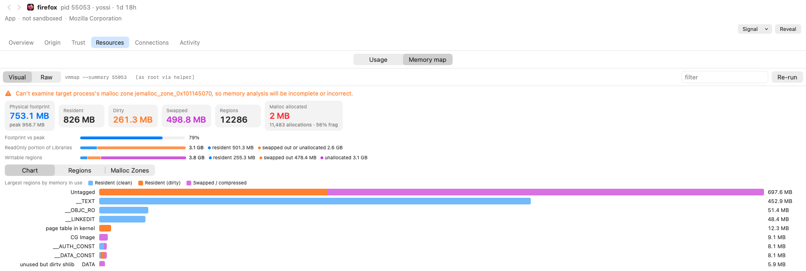
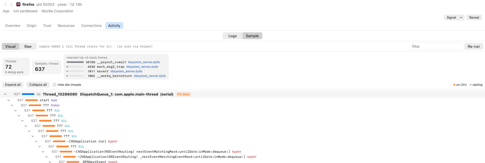

# ProcXRay

A Process Hacker–style process explorer for macOS that surfaces the attribution data macOS itself uses: responsible processes, coalitions, LaunchServices state, code signatures, launchd jobs and Background Task Management records.

## Screenshots

Process tree with the inspector on `launchd`, showing `vmmap --summary` parsed into footprint tiles, memory-portion bars and a per-region chart:



`sample` as a collapsible call tree: busy threads in orange, waits in grey, libraries colour-coded:



`lsof` as a typed, filterable table (here filtered to Unix and TCP sockets):


Entitlements grouped into Apple-private, sandbox/security and other:


`lsappinfo` and `launchctl print` rendered as cards:


Every pane has a **Visual / Raw** switch to see the tool's original text.

## Build & run

```bash
./build-app.sh
open build/ProcXRay.app
```

Requires full Xcode (`/Applications/Xcode.app`). The Command Line Tools SDK for macOS 27 lacks the SwiftUI macro plugin, so `@State` fails to compile with it.

`build-app.sh` signs with the first "Apple Development" identity in your keychain (override with `SIGN_ID=…`). It also rewrites the binary's recorded SDK version with `vtool`: SwiftPM records sdk = deployment target (14.0), which makes AppKit run the app in macOS 14 compatibility mode (opaque toolbar, thicker split divider and a visible kink where the sidebar meets the toolbar).

The app icon (a chip under an X-ray scan beam) is drawn in code by `tools/make-icon.swift`; regenerate `Resources/AppIcon.icns` with `swift tools/make-icon.swift Resources`.

## Privileged helper

The sidebar's **Install Privileged Helper…** button registers a root daemon through `SMAppService.daemon`. macOS asks you to approve it once under System Settings → General → Login Items. The helper is the same binary started by launchd as `ProcXRay --helper`.

- **Read-only.** It returns task metrics for every pid and args/env/cwd for a pid, and runs a fixed allowlist of tools whose command lines it builds itself: `lsof`, `vmmap --summary`, `sample`, `launchctl procinfo` and `sfltool dumpbtm`. It never accepts paths, commands or free-form arguments.
- **Mutual code-signing check, pinned to this build.** The helper's XPC listener only accepts a client that is this exact binary: identifier `local.procxray`, the same team, and the same cdhash (`setConnectionCodeSigningRequirement`). The app requires the same of the helper. Team ID and cdhash are read from the binary's own signature at runtime, so anything else signed with the same certificate is rejected. After a rebuild, a helper still running the old binary is rejected until it exits.
- **Per-user policy.** A caller in the `admin` group (who could run the same tools with `sudo`) can inspect any process. Other users get arguments, environment and tools only for their own processes, and no `sfltool dumpbtm`.
- **No files left behind.** `sample` writes its report to stdout instead of `/tmp`, and the helper runs with umask 077.
- **Exits when idle.** It quits about 10 s after the last connection closes, and launchd restarts it on demand.
- With the helper running, root-owned processes show memory, CPU, threads and arguments, and Background Items loads without a password prompt. `vmmap`/`sample` still cannot inspect Apple platform binaries (SIP).

## What it shows

- **Processes**: parent tree, responsible tree (apps that exited and left processes running appear as `†` groups), resource coalition groups, jetsam coalition groups (a host with its app extensions, each extension's resource coalition nested inside), or flat. Columns cover CPU, physical footprint, threads, user, responsible process, resource and jetsam coalition ids, signer, disk I/O and age; badges mark LEFT (outlived the app that launched it, as listed under Left Behind), ZOMBIE, ROSETTA, SBX (sandboxed) and EXITED.
- **Inspector** (double-click a process, press Return, or ⌘I; one window per process, like Activity Monitor's Inspect; or turn on the Inspector Pane, ⌥⌘I, to show the selected process below the list): General, Lineage (parent chain, children, processes it is responsible for, resource coalition members, and jetsam coalition members outside its resource coalition), Signature (team, authority chain, CDHash, static and runtime CS flags), Entitlements, Args & Env, Files & Sockets (`lsof`), Memory Map (`vmmap --summary`), Sample (`sample`, 1 s), Logs (`/usr/bin/log`, filtered to the pid), launchd/LaunchServices.
- **Visual / Raw**: every tool-backed pane is parsed (`Sys/Parsers.swift`) and drawn visually (`UI/Visualizers.swift`): lsof as a typed, filterable socket/file table with TCP state badges; vmmap as footprint tiles, portion bars, a region bar chart and sortable region/malloc-zone tables; sample as a collapsible call tree with per-thread busy/idle summaries; logs as a level-stacked event histogram plus table; launchctl print/procinfo and lsappinfo as cards; entitlements grouped into private / sandbox / other. A Visual/Raw switch (remembered app-wide) shows the original text, and output that can't be parsed (errors, permission notes) falls back to it automatically.
- **Left Behind**: processes that keep an app in the "running in background" state after it quits. Detected three ways: a responsible pid that no longer exists; LaunchServices entries marked `exited-with-subordinates`, matched through their coalition and related pids; and, once the app is launched again (LaunchServices then drops the exited entry), a running app whose `relatedCoalitionIDs` names a coalition other than its own, which is an earlier instance's. On macOS 27 a leftover reports itself as its own responsible process, so in practice the LaunchServices entries are what find it; leftovers of apps LaunchServices doesn't track (command-line tools) aren't detected. The LEFT badge, the Responsible column and the Responsible tree all use this same result.
- **LaunchServices Apps**: parsed `lsappinfo list`, including coalition members and related pids.
- **Background Items**: parsed `sfltool dumpbtm`. Loaded only on request. Through the helper it runs as root with no prompt; without the helper, `sfltool` asks for an admin password on every run.
- **launchd Jobs**: `launchctl list` plus `launchctl print` for the selected job.

## Data sources

- `sysctl(KERN_PROC_ALL)`, `KERN_PROCARGS2`, `proc_pidpath`, `proc_pidinfo` (task info, vnode paths, coalition flavor 20), `proc_pid_rusage` v4
- `responsibility_get_pid_responsible_for_pid` and `sandbox_check` (private libsystem symbols resolved with `dlsym`)
- Security.framework `SecCodeCopyGuestWithAttributes` / `SecCodeCopySigningInformation`
- `lsappinfo`, `launchctl`, `sfltool`, `lsof`, `vmmap`, `sample`, `/usr/bin/log`

Runs unprivileged. Task info, arguments and environment are only readable for your own processes; root-owned ones show `—`.

## Notes

- Built to be left running. Nothing refreshes while no ProcXRay window is on screen (hidden, minimized, covered, another Space, screen locked); measured ~0.07% CPU in that state. On screen, a 2 s refresh with ~800 processes costs roughly 3–5% of one core. LaunchServices and launchd lists are re-read every 5th tick, since `lsappinfo` is a subprocess spawn that also makes launchservicesd work.
- The process table is an `NSOutlineView`, not SwiftUI `Table`: rows are reused by id, the tree is updated with per-parent insert/remove/move, and visible cells are refreshed in place. The view hosting it doesn't read per-tick data, so SwiftUI doesn't re-render (and re-push its environment through every cell) on each refresh.

- `lsappinfo`'s `coalition:` field is the **jetsam** coalition id, not the resource coalition. The jetsam id is often the resource id + 1, but not always (on one machine, 116 of 703 processes differed), so match against both ids rather than deriving one from the other.
- Several resource coalitions can share one jetsam coalition: app extensions (widgets, wallpapers, QuickLook thumbnailers, `DeviceFS`) get a resource coalition of their own but join their host's jetsam coalition. The reverse (one resource coalition spanning several jetsam coalitions) wasn't observed.
- `PROC_PIDCOALITIONINFO` returns 40 bytes on current macOS; a 32-byte buffer fails.
- In zsh, `log` is a shell builtin that shadows `/usr/bin/log`. Always use the full path.
- `ProcXRay --bench` times each stage of a refresh tick (wall and CPU, including spawned tools) for performance work.
- `ProcXRay --dump [--pid N] [--btm]` prints a self-test snapshot for cross-checking against `ps` and `lsappinfo`. `--btm` triggers the password prompt.
- `ProcXRay --spawn-leftover` starts a detached `sleep 120` and exits, which reproduces the "app quit but a helper kept running" state.
