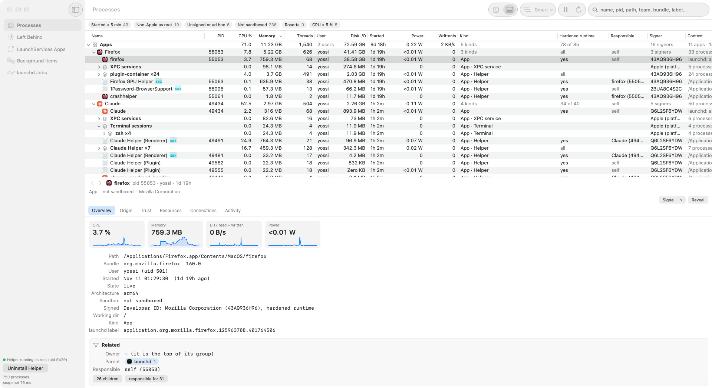
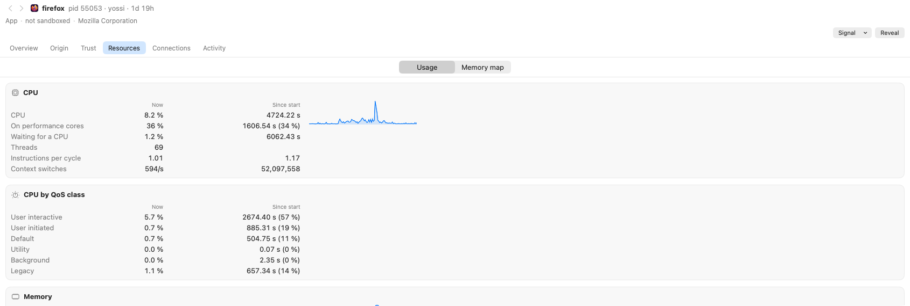
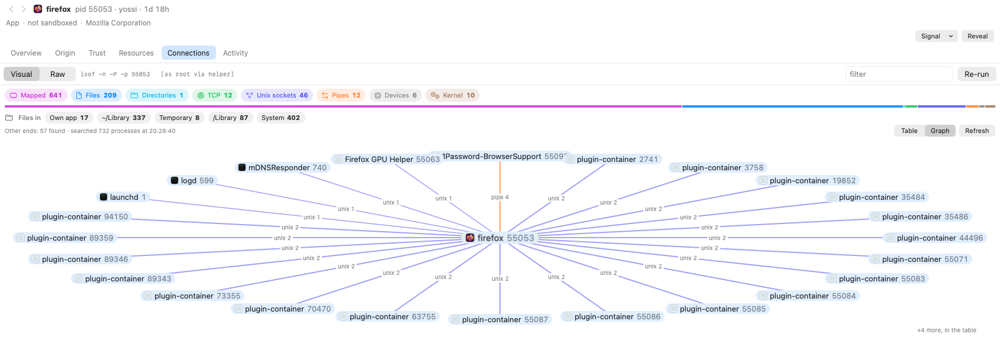

# Proc X-Ray

A Process Hacker–style process explorer for macOS. It shows the attribution data macOS itself uses: responsible processes, coalitions, LaunchServices state, code signatures, launchd jobs and Background Task Management records.



## Highlights

- **Smart process tree.** Every process is sorted into Apps, Background apps, Extensions, Third-party services, System interface and System services, with each app's helpers, XPC services and terminal sessions under it. You can switch to a parent, responsible or coalition tree, or to a flat list.
- **Rich columns.** About 50 columns cover CPU, memory, disk, energy, signing and launchd. Filter chips catch the usual suspects: unsigned, root, not sandboxed, Rosetta and recently started processes.
- **Inspector.** Six tabs (Overview, Origin, Trust, Resources, Connections and Activity) answer what a process is, who launched it, who signed it, what it's using and what it's talking to. Every process it mentions is a clickable link.
- **Left Behind.** Finds processes that keep an app "running in the background" after you quit it.
- **Visual, not just text.** The output of `lsof`, `vmmap`, `sample`, `log`, `launchctl` and `lsappinfo` is parsed into tables, charts and call trees. A Raw switch shows the original text.
- **Privileged helper (optional).** A read-only root daemon fills in data for root-owned processes and loads Background Items without a password prompt.

## A closer look

Resources: each figure now and since start, with sparklines and CPU time split by QoS class.



`vmmap --summary` drawn as footprint tiles, portion bars and a per-region chart.


Connections, with the other end of every pipe and socket resolved into a peer graph.



`sample` as a collapsible call tree, with busy threads in orange.


## Build & run

Requires full Xcode, not just the Command Line Tools.

```bash
./build-app.sh --release
open "build/Proc X-Ray.app"
```

Without `--release` you get `build/Proc X-Ray Dev.app`. It has its own bundle id, helper and settings, so it can run alongside the release build. `build-app.sh` signs with your first "Apple Development" identity; set `SIGN_ID=…` to use another.

## Privileged helper

Click **Install Privileged Helper…** in the sidebar, then approve it once in System Settings → General → Login Items. The helper:

- is read-only and runs only a fixed allowlist of tools (`lsof`, `vmmap`, `sample`, `launchctl procinfo` and `sfltool dumpbtm`), with arguments it builds itself.
- accepts connections only from this exact build of the app, matched by team ID and cdhash.
- lets admins inspect any process. Other users can inspect only their own processes.
- exits about 10 s after it goes idle. launchd restarts it on demand.

Without the helper the app runs unprivileged, and root-owned processes show `—`.

## More

- [docs/process-info-sources.md](docs/process-info-sources.md) lists where each piece of data comes from.
- `ProcXRay --dump [--pid N]` prints a snapshot for cross-checking. `--bench` times each refresh stage.
- Proc X-Ray aims to be very light on system resources.
