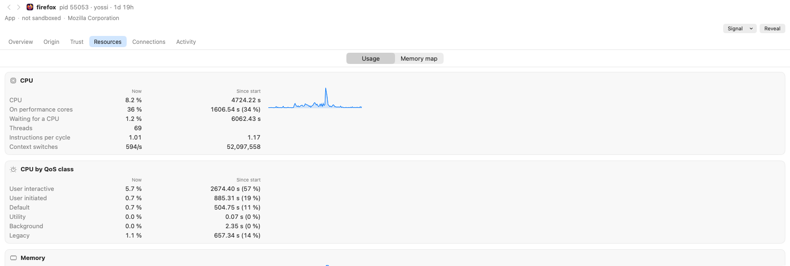
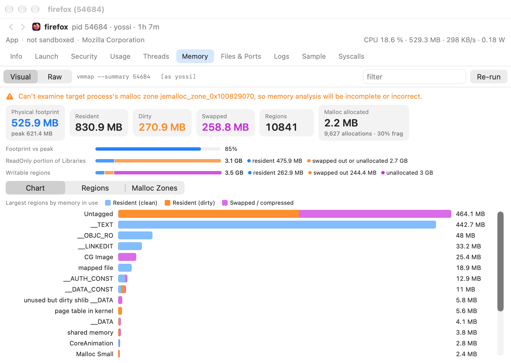
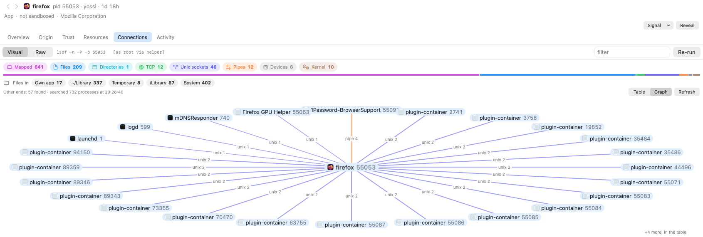
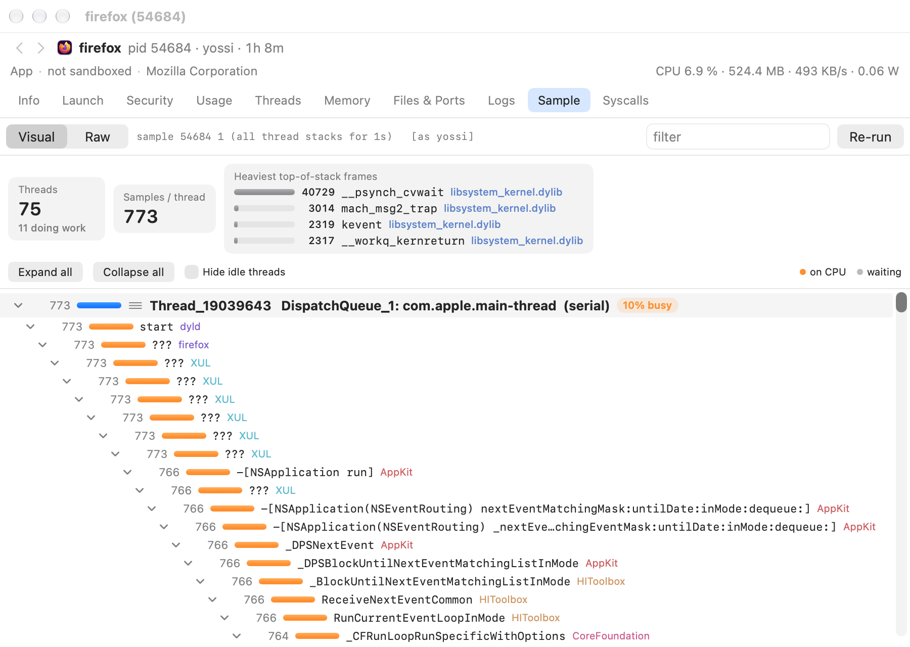

# Proc X-Ray

A Process Hacker–style process explorer for macOS. It shows the attribution data macOS itself uses: responsible processes, coalitions, LaunchServices state, code signatures, launchd jobs and Background Task Management records.


## Highlights

- **Smart process tree.** Every process is sorted into Left behind, Apps, Background apps, Extensions and Third-party services (third-party only), System interface and System services (Apple only), with each app's helpers, XPC services and terminal sessions under it; an app's row shows its own pid, path and parent. You can switch to a responsible/parent tree (each process under its responsible process, or under its parent when it has none), a flat list, or a flat list grouped by signer, user, launchd domain, sandbox or architecture, or click a column header to see every process in one flat list sorted by it (descending, then ascending, then back to the tree), as in Process Hacker. View ▸ Keep Groups When Sorting sorts inside the groups instead.
- **Rich columns.** About 75 columns in eleven sections (Identity, Execution, Lineage, CPU, GPU, Memory, Disk, Network, IPC, Energy, Security), each with what it means and where it comes from. Filter chips catch the usual suspects, and a predicate (`cpu > 5 and not sandboxed`) filters on any column. Saved filters sit in the sidebar.
- **Inspector.** Ten tabs (Info, Launch, Security, Usage, Threads, Memory, Files & Ports, Logs, Sample, Syscalls; ⌘1–⌘0) show what a process is, who started it and why, who signed it, what it's using and what it's talking to. Every field's name opens a bubble saying what it is and where it comes from, and every process it mentions is a clickable link.
- **Left Behind.** A built-in filter finds processes that keep an app "running in the background" after you quit it.
- **Visual, not just text.** The output of `lsof`, `vmmap`, `sample`, `log`, `launchctl` and `lsappinfo` is parsed into tables, charts and call trees. A Raw switch shows the original text.
- **Privileged helper (optional).** A read-only root daemon fills in data for root-owned processes and loads Background Items without a password prompt.

## A closer look

Usage: each figure now and since start, with sparklines and CPU time split by QoS class.



`vmmap --summary` drawn as footprint tiles, portion bars and a per-region chart.



Files & Ports, with the other end of every pipe and socket resolved into a peer graph.



`sample` as a collapsible call tree, with busy threads in orange.



## Build & run

Requires full Xcode, not just the Command Line Tools.

```bash
./build-app.sh --release
open "build/Proc X-Ray.app"
```

Without `--release` you get `build/Proc X-Ray Dev.app`. It has its own bundle id, helper and settings, so it can run alongside the release build. `build-app.sh` signs with your first "Apple Development" identity; set `SIGN_ID=…` to use another.

## Privileged helper

Click **Install Privileged Helper…** in Settings ▸ Helper (the helper part of the sidebar's status line opens it), then approve it once in System Settings → General → Login Items. The helper:

- is read-only and runs only a fixed allowlist of tools (`lsof`, `vmmap`, `sample`, `launchctl procinfo` and `sfltool dumpbtm`), with arguments it builds itself.
- accepts connections only from this exact build of the app, matched by team ID and cdhash.
- lets admins inspect any process. Other users can inspect only their own processes.
- exits about 10 s after it goes idle. launchd restarts it on demand.

Without the helper the app runs unprivileged, and what it can't read for root-owned processes shows `?`.

## More

- [docs/process-info-sources.md](docs/process-info-sources.md) lists where each piece of data comes from.
- `ProcXRay --dump [--pid N]` prints a snapshot for cross-checking. `--bench` times each refresh stage.
- Proc X-Ray aims to be very light on system resources.
